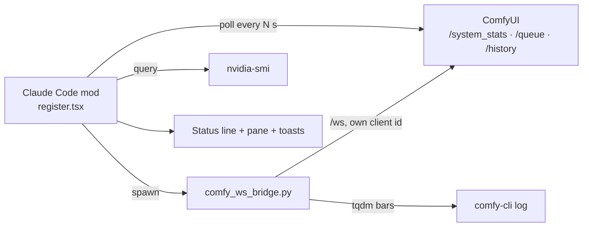

<div align="center">

# comfy-monitor

**A Claude Code mod that shows ComfyUI usage — status line, 10-minute charts, step progress and recent jobs — without opening the ComfyUI window.**<br>
**ComfyUI 창을 띄우지 않고 사용량·단계 진행률·최근 작업을 Claude Code 안에서 보여 주는 mod**

[](LICENSE)
[](https://docs.claude.com/en/docs/claude-code)
[](.claude-plugin/plugin.json)
[](https://github.com/comfyanonymous/ComfyUI)
[](#requirements--필요한-것)

</div>

---

## Demo / 미리보기

Status line example / 상태줄 예시:

```text
Comfy ● ON · Run 1 · Wait 2 · 단계 4/20 · VRAM 9.4/16G · GPU 87%
```

| Part / 항목 | Meaning / 뜻 |
| --- | --- |
| `Run` | Running jobs<br>실행 중인 작업 수 |
| `Wait` | Queued jobs<br>대기 중인 작업 수 |
| `단계 n/m` | Sampler step<br>샘플러 단계 |
| `⚠` before VRAM | VRAM stays high<br>VRAM이 높게 유지됨 |
| `Comfy ○ OFF` | ComfyUI does not respond<br>ComfyUI가 응답하지 않음 |

## Table of contents / 목차

- [Overview / 소개](#overview--소개)
- [Features / 기능](#features--기능)
- [How it works / 동작 방식](#how-it-works--동작-방식)
- [Requirements / 필요한 것](#requirements--필요한-것)
- [Installation / 설치](#installation--설치)
- [Quick start / 빠른 시작](#quick-start--빠른-시작)
- [Defaults and configuration / 기본값과 설정](#defaults-and-configuration--기본값과-설정)
- [Data sources / 데이터 출처](#data-sources--데이터-출처)
- [Repository layout / 저장소 구조](#repository-layout--저장소-구조)
- [Troubleshooting / 문제 해결](#troubleshooting--문제-해결)
- [Limitations / 한계](#limitations--한계)
- [Contributing / 기여](#contributing--기여)
- [Security / 보안](#security--보안)
- [License / 라이선스](#license--라이선스)

## Overview / 소개

`comfy-monitor` is a mod for Claude Code. It reads a local ComfyUI server and shows a one-line status line plus a pane with 10-minute charts of GPU, VRAM, RAM and the queue, the running job's sampler steps, and the recent jobs. It is handy when you run ComfyUI headless.

`comfy-monitor`는 Claude Code용 mod입니다. 로컬 ComfyUI 서버를 읽어 상태줄에 한 줄 요약을, 패널에 GPU·VRAM·RAM·큐의 최근 10분 그래프와 현재 작업의 샘플러 단계, 최근 작업 목록을 띄웁니다. ComfyUI 창 없이(헤드리스) 돌릴 때 쓰기 좋습니다.

## Features / 기능

| Area / 영역 | What it does / 하는 일 |
| --- | --- |
| **Status line**<br>**상태줄** | One line: ON/OFF, running and queued jobs, sampler step, VRAM, GPU.<br>한 줄 요약: ON/OFF, 실행·대기 작업, 샘플러 단계, VRAM, GPU. |
| **Pane**<br>**패널** | 10-minute charts of GPU, VRAM, RAM and the queue, the running job's steps, and the recent jobs.<br>GPU·VRAM·RAM·큐의 최근 10분 그래프, 현재 작업 진행률, 최근 작업 목록. |
| **Step progress**<br>**단계 진행률** | Sampler step n/m through a helper that reads the websocket and the comfy-cli log.<br>웹소켓과 comfy-cli 로그를 읽는 보조 스크립트로 샘플러 단계 n/m 표시. |
| **Toasts**<br>**알림** | A job finishes, fails or is interrupted (run time, failed node and message); VRAM stays above the threshold for over 10 s.<br>작업 완료·실패·중단(소요 시간, 실패 노드와 메시지), VRAM이 기준 이상으로 10초 넘게 지속될 때. |
| **Stop**<br>**종료** | `/comfy-monitor stop` stops the ComfyUI that comfy-cli launched; it asks first if jobs remain.<br>comfy-cli로 띄운 ComfyUI를 종료. 작업이 남아 있으면 먼저 물어봄. |
| **Persistence**<br>**유지** | The last 20 jobs and the last 10 minutes of samples are kept in the mod store and carry over to the next session.<br>최근 작업 20개와 최근 10분 샘플이 mod 저장소에 남아 다음 세션에서 이어짐. |
| **Offline handling**<br>**연결 끊김 처리** | After 3 failed polls in a row the line shows OFF and is rechecked every 10 s.<br>연속 3번 조회에 실패하면 OFF로 표시하고 10초마다 다시 확인. |

## How it works / 동작 방식



ComfyUI sends `progress` only to the client that queued the job. So the helper connects to `/ws` under its own id (jobs queued without a client_id) and also reads the tqdm bars in the comfy-cli log (every job on a ComfyUI launched by comfy-cli). It never uses another client's id.

ComfyUI는 `progress`를 작업을 넣은 클라이언트에게만 보냅니다. 그래서 보조 스크립트는 자기 id로 `/ws`에 붙고(client_id 없이 넣은 작업), comfy-cli 로그의 tqdm 막대도 함께 읽습니다(comfy-cli로 띄운 ComfyUI의 모든 작업). 다른 클라이언트의 id는 절대 쓰지 않습니다.

## Requirements / 필요한 것

| Tool / 도구 | Required / 필수 | Used for / 용도 |
| --- | --- | --- |
| Claude Code | Yes / 예 | Runs the mod<br>mod 실행 |
| Local ComfyUI (default `http://127.0.0.1:8188`) | Yes / 예 | The server to monitor<br>모니터링 대상 서버 |
| `nvidia-smi` | For GPU / GPU 표시용 | GPU usage, temperature, power<br>GPU 사용률·온도·전력 |
| Python with `websocket-client` | For step progress / 단계 진행률용 | `pip install websocket-client`; usually already in the comfy-cli venv<br>보통 comfy-cli를 설치한 venv에 이미 있음 |
| comfy-cli | For `stop` / `stop`용 | `/comfy-monitor stop`<br>ComfyUI 종료 |

If `comfy` or `python` is not on your PATH, set the full paths in `comfyBin` and `pythonBin`.

`comfy`나 `python`이 PATH에 없으면 설정의 `comfyBin`, `pythonBin`에 전체 경로를 넣으세요.

## Installation / 설치

**1. In the Claude Code input box / Claude Code 입력창에서**

```text
/plugin install comfy-monitor --marketplace aquarius21c/comfy-monitor
```

**2. From a shell / 셸에서**

```bash
claude plugin install comfy-monitor --marketplace aquarius21c/comfy-monitor
```

**3. Desktop app, where `/plugin` is unavailable / 데스크톱 앱(`/plugin`이 안 되는 곳)**

**+** next to the input box → **Plugins** → **Add marketplace** → enter `aquarius21c/comfy-monitor` → **Add plugin**.

입력창 옆 **+** → **Plugins** → **Add marketplace**에 `aquarius21c/comfy-monitor` 입력 → **Add plugin**.

## Quick start / 빠른 시작

Start ComfyUI, then open the pane. / ComfyUI를 켠 뒤 패널을 엽니다.

```text
/comfy-monitor
```

| Command / 명령 | Description / 동작 |
| --- | --- |
| `/comfy-monitor` | Open the pane (starts polling if it was off)<br>패널 열기 (꺼져 있으면 조회 시작) |
| `/comfy-monitor on` / `off` | Start / stop polling<br>조회 시작 / 중지 |
| `/comfy-monitor stop` | Stop the ComfyUI that comfy-cli launched (`comfy stop`). Asks first if jobs remain; `stop now` forces it<br>comfy-cli가 띄운 ComfyUI 종료. 작업이 남아 있으면 먼저 물어봄(`stop now`로 강제) |

## Defaults and configuration / 기본값과 설정

Set in `/config` or `pluginConfigs.comfy-monitor` in settings. / `/config` 또는 settings의 `pluginConfigs.comfy-monitor`에서 바꿉니다.

| Key / 키 | Default / 기본값 | Meaning / 뜻 |
| --- | --- | --- |
| `comfyUrl` | `http://127.0.0.1:8188` | ComfyUI address<br>ComfyUI 주소 |
| `intervalSeconds` | `2` | Poll interval in seconds<br>조회 주기(초) |
| `useNvidiaSmi` | `true` | Read GPU usage, temperature and power with `nvidia-smi`<br>`nvidia-smi`로 GPU 사용률·온도·전력 읽기 |
| `autoStart` | `true` | Start polling when a session starts<br>세션 시작 때 조회 시작 |
| `comfyBin` | `comfy` | comfy-cli used by `/comfy-monitor stop`<br>`stop`이 실행할 comfy-cli |
| `useBridge` | `true` | Run the step-progress helper `hooks/comfy_ws_bridge.py`<br>단계 진행률 보조 스크립트 실행 |
| `pythonBin` | `python` | Python for the helper (needs `websocket-client`)<br>보조 스크립트용 Python |
| `comfyLog` | empty / 비움 | Log to read progress from; empty uses comfy-cli's `background_log`<br>진행률을 읽을 로그. 비우면 comfy-cli 설정의 `background_log` |
| `vramWarnPercent` | `95` | VRAM warning threshold (%)<br>VRAM 경고 기준(%) |

## Data sources / 데이터 출처

- `GET /system_stats`: VRAM, torch VRAM, RAM, version, devices<br>VRAM, torch VRAM, RAM, 버전, 장치
- `GET /queue`: running and queued counts, node types of the running prompt<br>실행·대기 수, 실행 중인 프롬프트의 노드 종류
- `GET /history?max_items=10`: finished jobs; read when the queue shrinks and every 30 s<br>끝난 작업. 큐가 줄 때와 30초마다 읽음
- `nvidia-smi --query-gpu=utilization.gpu,temperature.gpu,power.draw`
- `hooks/comfy_ws_bridge.py`: sampler step n/m<br>샘플러 단계 n/m

## Repository layout / 저장소 구조

```text
comfy-monitor/
├── .claude-plugin/
│   ├── plugin.json         Mod manifest and user settings / mod 정보와 사용자 설정
│   └── marketplace.json    Marketplace entry / 마켓플레이스 등록 정보
├── hooks/
│   ├── register.tsx        Status line, pane, commands, toasts / 상태줄·패널·명령·알림
│   ├── comfy.ts            ComfyUI and nvidia-smi readers / ComfyUI·nvidia-smi 조회
│   ├── chart.ts            Chart drawing / 그래프 그리기
│   ├── comfy_ws_bridge.py  Step-progress helper / 단계 진행률 보조 스크립트
│   └── hooks.json          Hook entry / 훅 진입점
├── tests/                  Unit tests / 단위 테스트
├── types/index.d.ts        Mod API types / mod API 타입
└── LICENSE
```

## Troubleshooting / 문제 해결

| Symptom / 증상 | Fix / 해결 |
| --- | --- |
| Line shows `Comfy ○ OFF`<br>상태줄이 `Comfy ○ OFF` | ComfyUI is not responding. Check `comfyUrl` and that ComfyUI is running; it is rechecked every 10 s.<br>ComfyUI가 응답하지 않는 상태. `comfyUrl`과 실행 여부를 확인하세요. 10초마다 다시 확인합니다. |
| No `단계 n/m`<br>단계 n/m이 안 보임 | Install `websocket-client` in the Python set in `pythonBin`; keep `useBridge` on.<br>`pythonBin`의 Python에 `websocket-client`를 설치하고 `useBridge`를 켜 두세요. |
| Steps missing on ComfyUI Desktop<br>ComfyUI Desktop에서 단계가 안 보임 | Point `comfyLog` at the Desktop log file.<br>`comfyLog`에 Desktop 로그 파일 경로를 지정하세요. |
| `/comfy-monitor stop` does nothing<br>`stop`이 안 먹음 | It stops only a ComfyUI launched by comfy-cli; set the full path in `comfyBin` if `comfy` is not on PATH.<br>comfy-cli로 띄운 ComfyUI만 종료합니다. `comfy`가 PATH에 없으면 `comfyBin`에 전체 경로를 넣으세요. |
| No GPU numbers<br>GPU 수치가 없음 | Needs `nvidia-smi` and `useNvidiaSmi` on.<br>`nvidia-smi`와 `useNvidiaSmi` 켜짐이 필요합니다. |

## Limitations / 한계

- Reads a local ComfyUI; Comfy Cloud is not covered.<br>로컬 ComfyUI만 읽습니다. Comfy Cloud는 대상이 아닙니다.
- GPU numbers need `nvidia-smi` (NVIDIA GPUs).<br>GPU 수치는 `nvidia-smi`(NVIDIA GPU)가 필요합니다.
- Step progress covers jobs queued without a client_id and every job on a comfy-cli-launched ComfyUI, not other clients' jobs on other launches.<br>단계 진행률은 client_id 없이 넣은 작업과 comfy-cli로 띄운 ComfyUI의 작업만 대상이며, 다른 방식으로 띄운 서버의 다른 클라이언트 작업은 볼 수 없습니다.
- Developed and used on Windows; other platforms are untested (확인 필요).<br>Windows에서 개발·사용했고 다른 플랫폼은 확인하지 않았습니다(확인 필요).

## Contributing / 기여

Issues and pull requests are welcome. Run the checks below before opening a pull request.

이슈와 PR을 환영합니다. PR을 올리기 전에 아래 검사를 실행하세요.

```bash
claude plugin validate .
claude plugin test .
```

## Security / 보안

No API keys are needed. The mod talks only to the `comfyUrl` you set, `nvidia-smi` and the local comfy-cli log, and the helper never takes over another client's websocket id.

API 키가 필요 없습니다. 설정한 `comfyUrl`, `nvidia-smi`, 로컬 comfy-cli 로그만 읽고, 보조 스크립트는 다른 클라이언트의 웹소켓 id를 가로채지 않습니다.

## License / 라이선스

Released under the [MIT License](LICENSE). / [MIT 라이선스](LICENSE)로 공개합니다.

`comfy-monitor` is an independent project and is not affiliated with or endorsed by Anthropic or ComfyUI.<br>
`comfy-monitor`는 독립 프로젝트이며 Anthropic·ComfyUI와 제휴하거나 보증받지 않았습니다.

---

## English summary

comfy-monitor is a Claude Code mod that shows ComfyUI usage without opening the ComfyUI window: a status line (`Comfy ● ON · Run 1 · Wait 2 · 단계 4/20 · VRAM 9.4/16G · GPU 87%`, or `Comfy ○ OFF`) and a pane with 10-minute charts of GPU, VRAM, RAM and the queue, the running prompt's sampler steps, and the last finished jobs. It toasts when a job finishes, fails or is interrupted, and when VRAM stays at or over 95% for 10 s. Recent jobs and samples survive across sessions.

Install with `/plugin install comfy-monitor --marketplace aquarius21c/comfy-monitor`. It needs a local ComfyUI (`http://127.0.0.1:8188` by default), `nvidia-smi` for GPU %, and a Python with `websocket-client` for the step progress helper (`hooks/comfy_ws_bridge.py`, which reads ComfyUI's websocket under its own client id and the comfy-cli log's tqdm bars). Commands: `/comfy-monitor` (open the pane), `on` / `off`, `stop` (stop the ComfyUI comfy-cli launched). The UI text is Korean; settings are listed in the table above.
